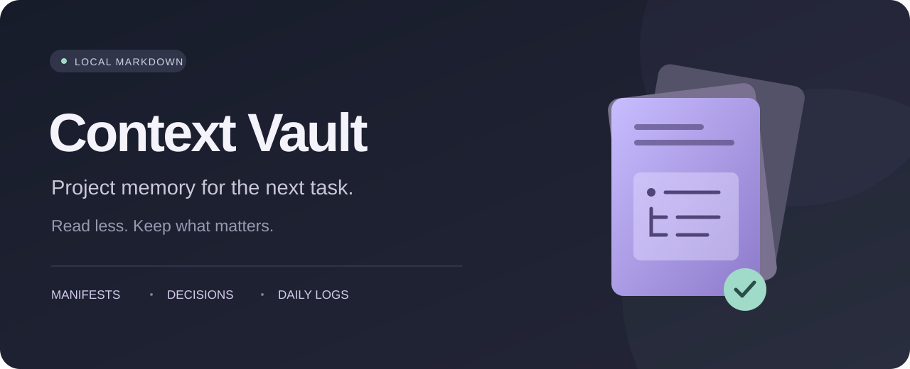
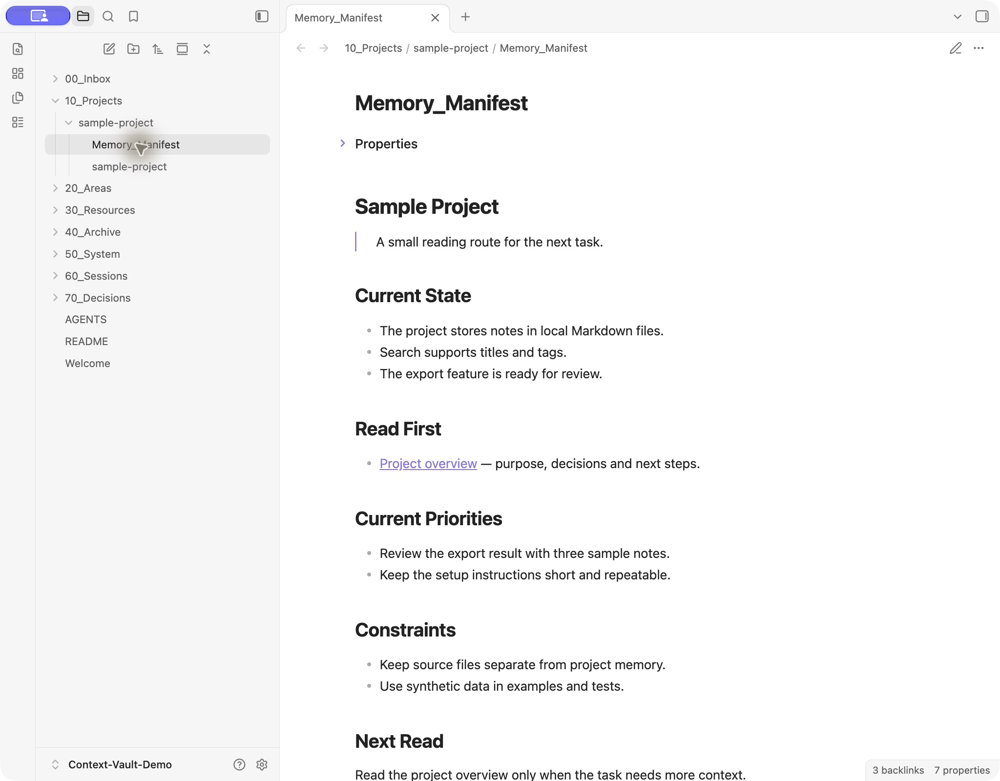
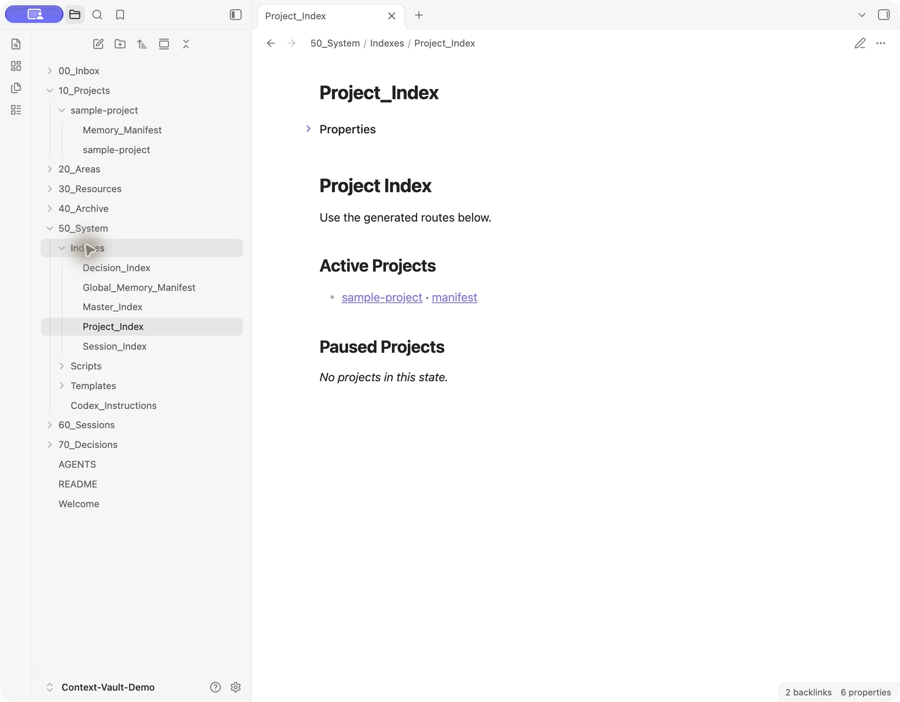

<p align="center"></p>

<p align="center">
  <a href="docs/HUMAN_GUIDE.md">Human guide</a> ·
  <a href="docs/AGENT_GUIDE.md">Agent guide</a> ·
  <a href="LICENSE">MIT license</a>
</p>

Keep project context between coding sessions in a local Markdown vault.
Read the current state first. Follow links to details. Save useful decisions
and next steps for the next task.

- **Local files.** Read and edit notes in Obsidian or any text editor.
- **Small reading routes.** Start with one project manifest.
- **Checked writes.** Validate note structure and reject stale replacements.
- **Explicit activation.** Choose which projects use memory.

## A Clear Place to Start



*An example project with synthetic notes.*



*Linked project routes in the example Vault.*

## Install

Requires Python 3.10 or later. No additional Python packages are needed.

```sh
git clone https://github.com/radixun/context-vault.git
cd context-vault
python3 install.py
```

The installer creates a new private Vault and skill. It supplies a harness
fragment and hooks for you to review and connect. Existing destinations are
never overwritten. Follow the [human guide](docs/HUMAN_GUIDE.md) to finish setup
and activate your first project.

## Included

| Component | Purpose |
| --- | --- |
| Local Vault | Clean folders, note templates and generated indexes |
| Agent skill | Read, write and validation procedures |
| Harness fragment | Activation rules for `AGENTS.md` |
| Hooks | Write feedback and a daily-log reminder |
| Python tools | Routing, revision checks, daily logs and audits |

Tested on macOS. Linux installation is available but not verified for this
release. Windows installation is not supported. The file tools include Windows
locks and daily-log names; this does not prove Windows installation or hook
acceptance. Codex hook trust requires a
user review; other harness adapters are not tested.

Context Vault has no network service. Your coding agent may send the notes it
reads to its model provider. Keep secrets out of project memory.
